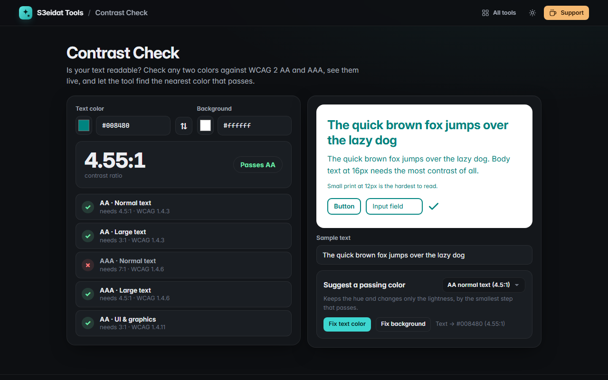

# Contrast Check

> WCAG 2 color contrast checker with a live sample and a one-click fix. Free, private, and it runs entirely in your browser.

### ▶ [Open Contrast Check](https://s3eidat.github.io/contrast-check/)



## Features

- **Contrast ratio** using the WCAG 2 relative luminance formula, shown truncated (never rounded up into a pass)
- Pass / fail for **AA and AAA, normal and large text**, and **UI components & graphics** (SC 1.4.3, 1.4.6, 1.4.11)
- Accepts any CSS color: hex, `rgb()`, `hsl()`, `hwb()`, `oklch()`, `oklab()` and named colors, plus color pickers
- **Transparency handled**: semi-transparent text is blended over the background before measuring
- **Live sample** with large, normal and small text, a button, an input and an icon; type your own sample text
- **Suggest a passing color**: keeps the hue (OKLCH) and changes only the lightness, by the smallest step that reaches AA, AA large or AAA; fix either the text or the background
- **Swap** colors; your last pair is remembered

## Privacy

Nothing you type leaves your device. There is no server, no account, no analytics.
The page ships with a strict Content-Security-Policy (`connect-src 'self'`), so the browser
itself blocks any attempt to send data anywhere.

## Run it yourself

It's plain HTML, CSS and JavaScript with no build step:

```bash
git clone https://github.com/s3eidat/contrast-check
cd contrast-check
python -m http.server 8000
```

Then open http://localhost:8000.

## Support

If this saved you time, **[buy me a coffee ☕](https://s3eidat.github.io/coffee/)**. It keeps every tool free.

---

Part of **[S3eidat Tools](https://s3eidat.github.io/)**: 100+ free, private tools that run in your browser. MIT licensed.
